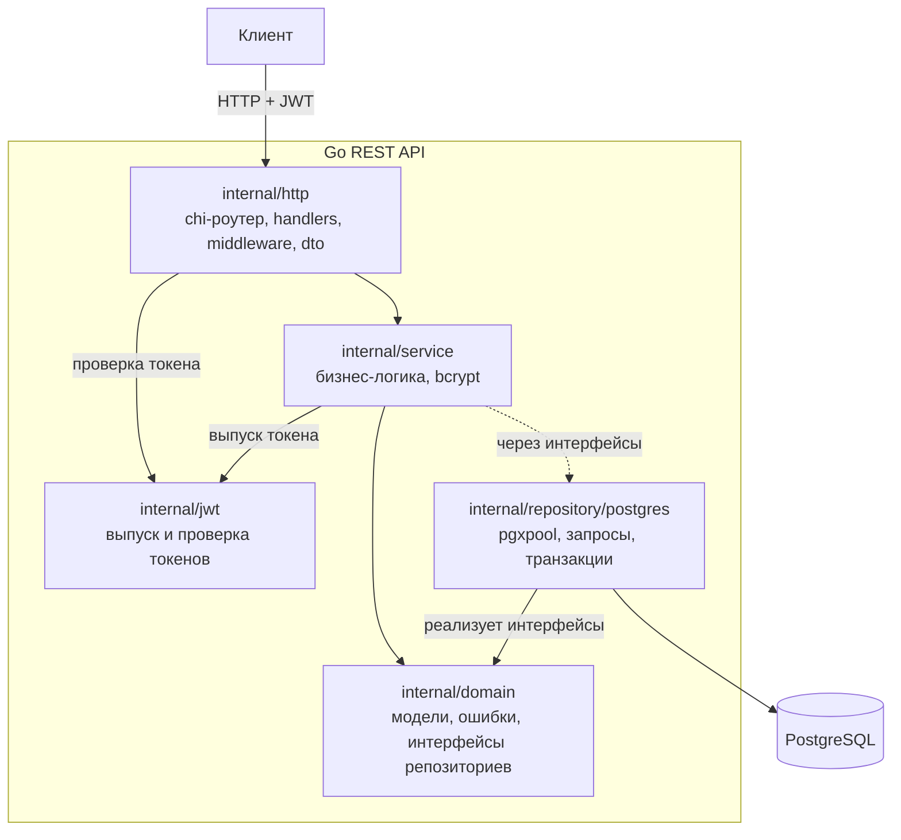

# REST API trans-pulse: архитектура

Слоёное приложение на Go: `chi` (HTTP), чистый `pgx` (PostgreSQL, без `database/sql`), JWT-авторизация в отдельном пакете.

## Слои и направление зависимостей



Правило: `http → service → domain ← repository`. `domain` ничего не импортирует, поэтому сервис тестируется без базы (репозитории подменяются). Пакет `jwt` независим от остальных слоёв.

## Структура проекта

```
cmd/
  api/main.go             сборка зависимостей, запуск, корректная остановка
  createadmin/main.go     создание первого администратора
internal/
  config/                 настройки из переменных окружения
  domain/                 модели, ошибки, интерфейсы репозиториев, правила статусов
  jwt/                    Manager: Generate / Parse (HS256)
  service/                auth, routes, vehicles, trips, incidents
  repository/postgres/    реализация интерфейсов на pgx
  http/                   router, middleware, handlers, dto (пакет называется httpapi, чтобы не путать с net/http)
migrations/               goose-миграции (схема из ЛР2)
docs/api/                 этот документ
```

## Поток запроса

1. Клиент отправляет HTTP-запрос с `Authorization: Bearer <JWT>`.
2. Middleware проверяет токен (`jwt.Parse`) и роль, кладёт пользователя в контекст.
3. Handler разбирает и проверяет входные данные, вызывает сервис.
4. Сервис применяет бизнес-правила (статусы рейса, активный рейс автобуса и т. д.).
5. Репозиторий выполняет SQL через pgx; ошибки БД переводятся в ошибки домена.
6. Handler возвращает JSON; ошибки домена преобразуются в HTTP-коды.

## Эндпоинты (`/api/v1`)

| Метод и путь | Доступ |
|---|---|
| `GET /health` | открытый |
| `POST /auth/register` (создаёт роль DISPATCHER), `POST /auth/login` | открытый |
| `GET /routes`, `GET /routes/{id}`, `GET /routes/{id}/stops`, `GET /stops` | открытый |
| `GET /auth/me` | любой вошедший |
| `GET /vehicles`, `GET /trips`, `GET /trips/{id}`, `GET /incidents`, `POST /incidents/{id}/resolve` | DISPATCHER, ADMIN |
| `POST /routes`, `PUT /routes/{id}`, `DELETE /routes/{id}` | ADMIN |
| `POST /vehicles`, `PATCH /vehicles/{id}` (смена статуса) | ADMIN |
| `POST /trips`, `POST /trips/{id}/start`, `/complete`, `/cancel` | ADMIN |

## Ошибки

Единый формат: `{"error": {"code": "not_found", "message": "..."}}`.

| Ошибка домена | HTTP | code |
|---|---|---|
| неверные данные | 400 | `invalid_input` |
| нет или неверный токен, неверный логин или пароль | 401 | `unauthorized` |
| недостаточно прав | 403 | `forbidden` |
| объект не найден | 404 | `not_found` |
| конфликт (дубликат, недопустимый переход статуса, второй активный рейс автобуса) | 409 | `conflict` |
| внутренняя ошибка | 500 | `internal` |

## Настройки (переменные окружения)

| Переменная | Назначение |
|---|---|
| `DATABASE_URL` | строка подключения к PostgreSQL (обязательна) |
| `JWT_SECRET` | секрет подписи токенов, не короче 32 символов (обязателен, только в `.env`, в git не хранится) |
| `JWT_TTL` | срок жизни токена, по умолчанию `1h` |
| `HTTP_ADDR` | адрес сервера, по умолчанию `:8080` |

## Запуск и проверка

1. База: `docker start go_postgres` (или `docker compose up -d`), создать БД `trans-pulse_api` и применить миграции: `make api-migrate` (строка подключения — `API_DATABASE_URL`).
2. Настройки: `cp .env.example .env`, подставить свой `JWT_SECRET` (например, `openssl rand -hex 32`). Файл `.env` в git не попадает.
3. Первый администратор: `make create-admin LOGIN=boss ADMIN_PASSWORD='длинный-пароль'` (пароль передаётся через окружение, а не аргументом команды).
4. Сервер: `make api-run`.
5. Тесты: `make api-test` (юнит-тесты и интеграционные тесты репозиториев на отдельной БД `trans-pulse_api_test`, переменная `API_TEST_DATABASE_URL`).
6. Живая проверка через curl: `ADMIN_PASSWORD='...' DATABASE_URL="$API_DATABASE_URL" bash scripts/api_smoke.sh` (вход, роли, жизненный цикл рейса, правило «один активный рейс на автобус», инциденты).

## Ограничения

- Токен проверяется без обращения к БД: отключение пользователя или смена роли вступают в силу после истечения токена (`JWT_TTL`).
- Инциденты создаёт система мониторинга (в этом API их можно только смотреть и закрывать).

## Не входит в эту версию

MongoDB и телеметрия, OpenAPI-файл, управление пользователями и остановками через API, refresh-токены.
