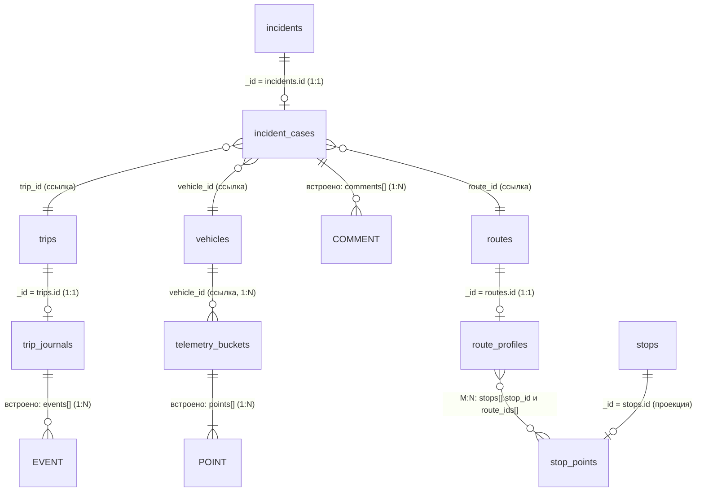

# Документная модель MongoDB: коллекции и связи

База `trans_pulse`, пять коллекций. Создаются и обновляются кодом `internal/repository/mongo/schema.go` при каждом старте приложения (`EnsureSchema`).



Сущности в верхнем регистре (`POINT`, `EVENT`, `COMMENT`) — встроенные элементы массивов, отдельных коллекций у них нет. Остальные слева — таблицы PostgreSQL.

## Коллекции

| Коллекция | Один документ — это | Ключ | Связь с PostgreSQL |
|---|---|---|---|
| `telemetry_buckets` | все GPS-точки одного автобуса за один час | `_id` (ObjectId) + уникальный индекс `(vehicle_id, hour)` | ссылка `vehicle_id` на `vehicles.id` |
| `trip_journals` | журнал событий одного рейса | `_id` = `trips.id` | один к одному с рейсом |
| `incident_cases` | карточка расследования одного инцидента | `_id` = `incidents.id` | один к одному с инцидентом; ссылки `trip_id`, `vehicle_id`, `route_id`, `created_by`, `closed_by`, `comments[].author_id` |
| `stop_points` | остановка: проекция из PostgreSQL + гибкие атрибуты + гео-точка | `_id` = `stops.id` | проекция строки `stops` |
| `route_profiles` | состав одного маршрута (упорядоченные ссылки на остановки) | `_id` = `routes.id` | проекция `route_stops` |

## Типы связей

**1:N**
- автобус → корзины телеметрии (ссылка `vehicle_id`), а внутри корзины корзина → точки (встроено);
- рейс → события журнала (встроено в `trip_journals.events`);
- карточка инцидента → комментарии (встроено в `incident_cases.comments`).

**M:N — маршруты ↔ остановки.** Остановка входит в несколько маршрутов, маршрут состоит из многих остановок. В документной модели связь хранится ссылками **с обеих сторон**:
- у маршрута: `route_profiles.stops = [{stop_id, seq}, …]` — упорядоченный список ссылок;
- у остановки: `stop_points.route_ids = [route_id, …]` — обратные ссылки (индексированы), по ним быстро отвечаем на вопрос «какие маршруты проходят через остановку».

Источник истины для этой связи — `route_stops` в PostgreSQL; документы MongoDB — проекция, которую приложение поддерживает при каждом изменении состава маршрута (см. ADR-006).

## Индексы

| Коллекция | Индекс | Для чего |
|---|---|---|
| `telemetry_buckets` | `(vehicle_id, hour)` уникальный | атомарный upsert корзины; чтение истории автобуса по диапазону времени |
| `incident_cases` | `trip_id`; `(vehicle_id, status)` | поиск карточек по рейсу и по автобусу |
| `stop_points` | `location` (`2dsphere`); `route_ids` | поиск ближайших остановок; остановки маршрута |

## Примеры документов (получены на живой БД)

`telemetry_buckets`:
```json
{ "_id": ObjectId("6af2fb17…"), "vehicle_id": 2, "hour": ISODate("2026-10-01T08:00:00Z"), "count": 2,
  "points": [
    { "ts": ISODate("2026-10-01T08:00:10Z"), "lat": 50.4501, "lon": 30.5234, "speed": 32.5, "trip_id": 4 },
    { "ts": ISODate("2026-10-01T08:00:20Z"), "lat": 50.451,  "lon": 30.524,  "speed": 35 } ],
  "schema_version": 1 }
```

`incident_cases` (закрытая карточка; ссылки — числа из PostgreSQL):
```json
{ "_id": 2, "trip_id": 4, "vehicle_id": 2, "route_id": 3, "title": "Разбор задержки рейса",
  "tags": ["delay", "traffic", "resolved"], "status": "CLOSED",
  "comments": [ { "author_id": 5, "text": "Водитель сообщил о пробке", "at": ISODate("2026-11-10T11:08:07Z") } ],
  "created_by": 5, "created_at": ISODate("…"), "updated_at": ISODate("…"),
  "closed_at": ISODate("…"), "closed_by": 5, "schema_version": 1 }
```
